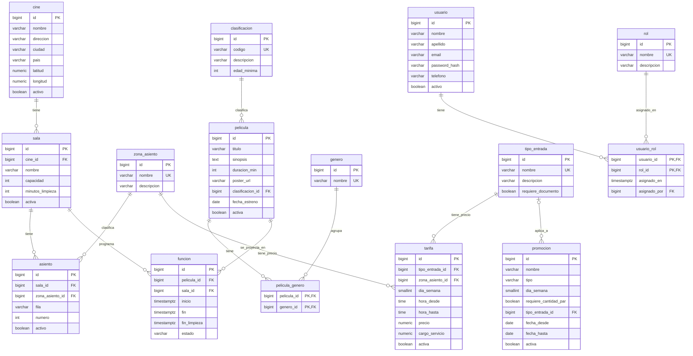

# Módulo A: catálogo, salas, programación y tarifas

**Responsable:** Matías Esquivel Lizano
**Scripts:** `database/ddl/01_catalogo.sql` y `database/seeds/01_catalogo_demo.sql`

## 1. Alcance

El módulo A guarda todo lo que existe antes de vender un boleto: dónde están los cines, cómo es cada sala, qué películas hay, cuándo se proyectan y cuánto cuesta cada entrada. Los módulos de venta (B) y de acceso (C) dependen de estas tablas, por eso su script se ejecuta primero.

Por acuerdo del equipo, `01_catalogo.sql` también crea las tablas base de usuarios y roles (`usuario`, `rol` y `usuario_rol`), porque la venta las necesita como llave foránea desde el inicio. El módulo C las amplía en `02_seguridad_usuarios.sql` (intentos fallidos, bloqueo y formato del hash).

Reglas de negocio que cubre: RN-01, RN-02, RN-06, RN-07, RN-08 y RN-18, además del proceso de programación sin traslapes.

## 2. Diagrama entidad-relación



GitHub dibuja este diagrama automáticamente. Para la entrega en PDF se puede exportar desde el editor de Mermaid o rehacer en otra herramienta.

## 3. Cardinalidades

| Relación | Cardinalidad | Explicación |
|---|---|---|
| cine – sala | 1 a N | Un cine tiene varias salas; una sala pertenece a un solo cine |
| sala – asiento | 1 a N | Cada asiento es único por sala, fila y número |
| zona_asiento – asiento | 1 a N | Cada asiento pertenece a una zona (General, VIP, Accesible) |
| clasificacion – pelicula | 1 a N | Cada película tiene una sola clasificación de edad |
| pelicula – genero | N a M | Se resuelve con la tabla intermedia `pelicula_genero` |
| pelicula – funcion | 1 a N | Una película se proyecta en muchas funciones |
| sala – funcion | 1 a N | Una sala tiene muchas funciones, sin traslape en el tiempo |
| tipo_entrada y zona_asiento – tarifa | 1 a N cada una | Una tarifa es el precio de un tipo de entrada en una zona, día y franja horaria |
| tipo_entrada – promocion | 0..1 a N | Una promoción puede aplicar a un tipo de entrada o a todos (si queda vacío) |
| usuario – rol | N a M | Se resuelve con `usuario_rol` |

## 4. Diseño lógico

### 4.1 Convenciones

- Nombres en `snake_case` y en singular.
- Llave primaria `id` de tipo `bigint generated always as identity`.
- Llaves foráneas con el nombre `<tabla>_id`.
- Fechas y horas en `timestamptz`; dinero en `numeric(12,2)`.
- `on delete restrict` en las tablas con historial, para que no se pueda borrar un cine, una sala o una película que ya tiene datos asociados. La excepción es `pelicula_genero`, que se borra en cascada con la película.

### 4.2 Normalización

Las tablas están en tercera forma normal:

- **1FN:** todas las columnas son atómicas. Los géneros de una película no se guardan como lista en una columna, sino en `pelicula_genero`.
- **2FN:** las tablas con llave compuesta (`pelicula_genero`, `usuario_rol`) no tienen columnas que dependan solo de una parte de la llave.
- **3FN:** no hay dependencias transitivas. Por ejemplo, la ciudad y la dirección están en `cine` y no se repiten en `sala`; la edad mínima está en `clasificacion` y no en `pelicula`.

La única redundancia controlada es `funcion.fin` y `funcion.fin_limpieza`, que se podrían calcular con la duración de la película y los minutos de limpieza de la sala. Se guardan porque la restricción de no traslape necesita esas columnas, y un trigger las mantiene correctas (ver sección 5.2).

### 4.3 Restricciones de integridad

| Tabla | Restricción | Para qué sirve |
|---|---|---|
| `cine` | `unique (nombre, ciudad)`; latitud entre -90 y 90; longitud entre -180 y 180 | No duplicar cines y validar coordenadas |
| `sala` | `unique (cine_id, nombre)`; `capacidad > 0`; `minutos_limpieza >= 0` | No duplicar salas dentro de un cine |
| `asiento` | `unique (sala_id, fila, numero)`; `numero > 0` | Un asiento existe una sola vez en cada sala |
| `pelicula` | `duracion_min > 0` | La hora de fin de la función depende de este valor |
| `funcion` | `estado in ('Activa', 'Cancelada', 'Finalizada')`; `fin >= inicio`; `fin_limpieza >= fin`; `exclude using gist` | Estados válidos y no traslape en la sala |
| `tarifa` | `dia_semana` entre 1 y 7 o nulo; `hora_hasta > hora_desde`; `precio >= 0`; `cargo_servicio >= 0`; índice único por tipo, zona, día y hora de inicio | Precios válidos y sin tarifas duplicadas |
| `promocion` | `tipo in ('2X1')`; fechas coherentes; debe tener un día o exigir cantidad par | Una promoción siempre tiene una condición para aplicarse |
| `usuario` | Correo con formato válido; índice único sobre `lower(email)` | No permitir el mismo correo con distinta capitalización |

## 5. Decisiones de diseño

### 5.1 No traslape de funciones con `EXCLUDE`

La licitación pide que no existan traslapes que impidan limpiar o preparar la sala. Se resolvió en la base de datos con una restricción de exclusión:

```sql
exclude using gist (sala_id with =, tstzrange(inicio, fin_limpieza) with &&)
    where (estado <> 'Cancelada')
```

Significa: no pueden existir dos funciones de la misma sala (`=`) cuyos rangos de tiempo se crucen (`&&`). El rango termina en `fin_limpieza`, así que el tiempo de limpieza también queda protegido. Las funciones canceladas no cuentan, para que se pueda reprogramar en ese espacio.

Se eligió esta opción en lugar de validar en la aplicación porque la restricción también funciona si dos administradores guardan funciones al mismo tiempo. Requiere la extensión `btree_gist`, que permite usar `=` sobre un `bigint` dentro de un índice GiST.

### 5.2 Cálculo automático del fin de la función

El trigger `trg_funcion_calcular_fin` se ejecuta antes de insertar o de cambiar la película, la sala o la hora de inicio de una función:

- `fin = inicio + duración de la película`
- `fin_limpieza = fin + minutos de limpieza de la sala`

Así el administrador solo indica la hora de inicio y nunca puede escribir un fin incorrecto que burle la restricción de traslape.

### 5.3 Matriz de tarifas

Una tarifa es el precio de un **tipo de entrada** (adulto, niño, tercera edad, estudiante) en una **zona** (General, VIP, Accesible), opcionalmente limitado a un **día de la semana** y a una **franja horaria**. Cuando `dia_semana` es nulo, la tarifa aplica todos los días. El índice único usa `coalesce(dia_semana, 0)` porque en PostgreSQL dos valores nulos no se consideran iguales y sin eso se podrían duplicar las tarifas generales.

El cargo por servicio se guarda en la misma tarifa para que el cálculo del total (RN-08) tome todo de un solo lugar.

### 5.4 Promociones 2x1

Una promoción se aplica cuando se cumple su condición: un día de la semana específico, una cantidad par de entradas de la misma categoría, o ambas. La restricción `ck_promocion_condicion` impide crear una promoción sin ninguna condición. `tipo_entrada_id` nulo significa que aplica a cualquier tipo de entrada.

### 5.5 Validación de tarifas especiales

`tipo_entrada.requiere_documento` marca las entradas con descuento que el operador de puerta debe validar con un documento de identidad (RN-06).

## 6. Lógica del módulo (`05_catalogo_logica.sql`)

| Pieza | Regla | Qué hace |
|---|---|---|
| `fn_listar_cartelera(p_cine, p_fecha, p_genero)` | RN-01, RN-02 | Lista funciones activas y futuras de películas, salas y cines activos. Filtros opcionales por cine o ciudad, fecha y género. Sin fecha, muestra los próximos 7 días |
| `fn_calcular_total(p_funcion_id, p_asientos, p_tipos_entrada)` | RN-07, RN-08 | Calcula subtotal, descuento 2x1, cargo por servicio, total y el detalle por asiento |
| `fn_sala_tiene_ventas(p_sala_id)` | RN-18 | Indica si la sala tiene asientos vendidos o con bloqueo vigente en funciones que no han terminado |
| Triggers `trg_asiento_rn18` y `trg_sala_rn18` | RN-18 | Impiden insertar, cambiar o borrar asientos, y cambiar la capacidad, el cine, el estado o borrar la sala, si hay ventas activas |

### 6.1 Cartelera

- Es una función en SQL simple (no PL/pgSQL), marcada `stable`. PostgreSQL la "abre" dentro de la consulta que la llama, así que puede usar los índices y su plan se puede revisar con `EXPLAIN ANALYZE`.
- El filtro de fecha se escribe como un rango sobre `inicio` (desde la medianoche hasta la medianoche siguiente, en hora de Costa Rica) y no como `inicio::date = p_fecha`, porque convertir la columna impide usar el índice.
- El filtro de cine busca el texto dentro del nombre del cine o de la ciudad, sin importar mayúsculas (`ilike`). El de género funciona igual.
- Devuelve: `funcion_id`, `titulo`, `sinopsis`, `clasificacion`, `genero` (todos los géneros separados por coma), `duracion_min`, `poster_url`, `cine`, `ubicacion` (dirección, ciudad y país), `sala`, `inicio` y `fin`. Son los campos que usa `app/public/catalogo/cartelera.js`.

### 6.2 Cálculo del total

**Cambio de contrato.** El contrato original era `fn_calcular_total(asientos[], tipos[])`, pero las tarifas dependen del día de la semana y de la hora, y la promoción "2x1 los miércoles" depende del día. Sin la función, no se puede saber cuál tarifa aplica. Por eso se agregó `p_funcion_id` como primer parámetro y se actualizó la ruta `POST /api/catalogo/total`, que ahora recibe `{ funcion_id, asientos, tipos }`. El módulo B ya la usa con este contrato en `fn_asignar_tipos` para guardar los totales de la orden.

Reglas que aplica:

1. **Validaciones:** al menos un asiento, un tipo de entrada por asiento, sin asientos repetidos, todos de la sala de la función y activos, y que exista tarifa para cada uno. Si algo falla, lanza un error con un mensaje claro.
2. **Tarifa por asiento:** busca la tarifa del tipo de entrada y la zona del asiento que aplique al día y la hora de la función. Si hay varias, gana la más específica: primero la de un día concreto sobre la de todos los días, después la franja horaria más corta. Ejemplo: un adulto el martes a las 11:00 paga la tarifa del martes ($6,00) y no la de matiné ($7,00).
3. **2x1 (RN-07):** se agrupan las entradas por tipo. Si hay una promoción vigente para ese tipo (por día, por fechas o para todos los tipos), de cada 2 entradas 1 es gratis, empezando por las más baratas. Con 3 entradas, 1 es gratis.
4. **Cargo por servicio:** se suma el de cada asiento, incluido el gratis.
5. **Total (RN-08):** `subtotal − descuento + cargo_servicio`, la misma fórmula que exige el `check` de la tabla `orden` del módulo B.

### 6.3 RN-18

- Se considera venta activa una reserva `VENDIDO`, un bloqueo `BLOQUEADO` que todavía no vence o un boleto `EMITIDO`, en una función activa que no ha terminado (`fin > now()`).
- Un bloqueo vencido no cuenta aunque todavía no lo haya liberado `fn_liberar_expirados`, porque ese asiento ya se puede vender a otra persona.
- Solo se protegen las columnas que cambian la distribución física. Cambiar el nombre de la sala sí se permite.
- Como `fn_sala_tiene_ventas` consulta `reserva_asiento` y `boleto`, este script se ejecuta después de `03_venta.sql`.

## 7. Diseño físico (índices)

Los índices están en `database/ddl/10_catalogo_indices.sql` y se justificaron con `EXPLAIN ANALYZE` sobre 907 508 funciones y 2 039 880 boletos (detalle en `database/explain/README.md`).

| Índice | Consulta que acelera | Efecto medido |
|---|---|---|
| `idx_funcion_activa_inicio` (parcial, solo funciones activas) | Cartelera | `Seq Scan on funcion` pasa a `Bitmap Index Scan`; cartelera por ciudad y fecha de 41,9 ms a 7,8 ms |
| `idx_pelicula_genero_genero` | Cartelera por género | `Seq Scan on pelicula_genero` pasa a `Bitmap Index Scan`; de 208,8 ms a 118,8 ms junto con el anterior |
| `idx_boleto_emitido` con `include (funcion_id, estado)` | Top 5 | `Parallel Seq Scan on boleto` pasa a `Index Only Scan`; de 409,0 ms a 191,1 ms |
| `idx_sala_cine`, `idx_funcion_pelicula` | Joins por llave foránea | Con estos datos el optimizador no los necesitó; sirven al crecer las tablas y al borrar o actualizar filas padre |

`idx_boleto_emitido` es sobre una tabla del módulo B, pero lo usa la consulta del módulo A. Se dejó en el script del catálogo, avisando al dueño del módulo B para no duplicarlo en `08_venta_indices.sql`.

## 8. Archivos del módulo

| Archivo | Contenido |
|---|---|
| `database/ddl/01_catalogo.sql` | Tablas, restricciones y trigger del fin de la función |
| `database/ddl/05_catalogo_logica.sql` | Cartelera, cálculo del total y RN-18 |
| `database/ddl/10_catalogo_indices.sql` | Índices de cartelera y Top 5 |
| `database/seeds/01_catalogo_demo.sql` | Datos pequeños de demostración |
| `database/seeds/12_masivo_catalogo.sql` | Datos masivos para rendimiento |
| `database/queries/20_consulta_top5.sql` | Consulta analítica 2 |
| `database/explain/` | Planes antes y después, y su análisis |
| `database/tests/05_catalogo_logica.sql` | Pruebas del módulo y su resultado |
| `docs/04-pruebas/catalogo.md` | Evidencia de las pruebas |
| `app/src/routes/catalogo.js` | Rutas de cartelera, total, Top 5 y resumen del dashboard |
| `app/public/catalogo/` | Pantallas de cartelera y administración del catálogo |
| `app/public/dashboard.html` | Dashboard con métricas que se refrescan cada 30 segundos |
| `docs/03-diseno/wireframes.md` | Wireframes de todas las pantallas |
