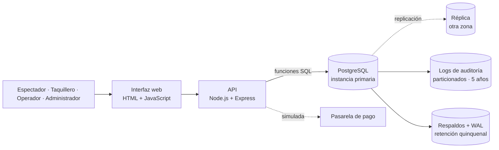
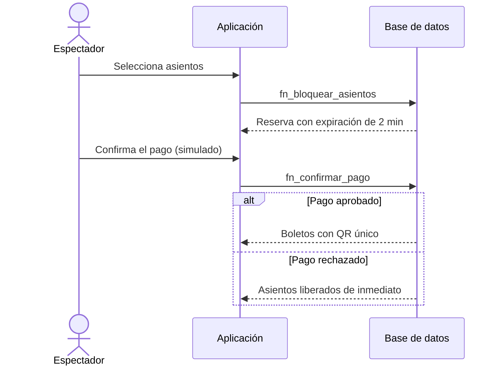

<div align="center">

# Ecosistema Digital de Cines IMAX

### Propuesta de licitación: diseño e implementación del ciclo de vida de la base de datos

**Proyecto 2 · Bases de Datos · II Semestre 2026**

Instituto Tecnológico de Costa Rica
[Administración de Tecnologías de la Información] · [TI-3600-Bases de Datos] · Profesora: [Jacqueline Tatiana Solis Cespedes]


</div>

---

## Resumen

IMAX Corporation abrió una licitación global para modernizar y escalar su plataforma de venta de entradas. El escenario heredado (una única base de datos en un computador de escritorio, tráfico por una conexión residencial, reservas en una hoja de cálculo y números de tarjeta enviados por mensajería) resulta inviable ante un estreno mundial con **8 millones de usuarios concurrentes** y picos de **50 000 transacciones por segundo**.

Este repositorio contiene la propuesta técnica del equipo: un **dictamen de rechazo** de la infraestructura heredada y el diseño, la implementación y la validación de una base de datos relacional **PostgreSQL** que garantiza propiedades **ACID**, impide la **doble venta de asientos**, cumple los principios de **PCI-DSS** (sin almacenar datos sensibles de tarjetas), controla el acceso mediante **RBAC** y conserva **auditoría inalterable durante 5 años**. Una interfaz web de apoyo permite demostrar los flujos de negocio de extremo a extremo.

## Tabla de contenido

1. [Contexto y problema](#1-contexto-y-problema)
2. [Objetivos](#2-objetivos)
3. [Alcance y fases del ciclo de vida de la BD](#3-alcance-y-fases-del-ciclo-de-vida-de-la-bd)
4. [Arquitectura propuesta](#4-arquitectura-propuesta)
5. [Modelo de datos](#5-modelo-de-datos)
6. [Reglas de negocio y su garantía en la base de datos](#6-reglas-de-negocio-y-su-garantía-en-la-base-de-datos)
7. [Seguridad y control de acceso (RBAC)](#7-seguridad-y-control-de-acceso-rbac)
8. [Estructura del repositorio](#8-estructura-del-repositorio)
9. [Instalación y ejecución](#9-instalación-y-ejecución)
10. [Pruebas y evidencias](#10-pruebas-y-evidencias)
11. [Metodología de trabajo](#11-metodología-de-trabajo)
12. [Equipo](#12-equipo)
13. [Documentación](#13-documentación)
14. [Estado del proyecto](#14-estado-del-proyecto)
15. [Referencias](#15-referencias)

---

## 1. Contexto y problema

La licitación exige una solución integral que cubra todo el ciclo de vida del servicio: exploración de cartelera, selección interactiva de asientos en tiempo real, pagos seguros, emisión de códigos QR únicos, control de acceso automatizado en puerta y un panel de administración centralizado.

La propuesta técnica del proveedor saliente fue calificada por el comité evaluador como inviable. Sus principales deficiencias, que se analizan en el dictamen de rechazo, son:

| Componente heredado | Deficiencia principal |
|---|---|
| Base de datos en Access/SQLite sobre un equipo de escritorio | Sin concurrencia de escritura, sin alta disponibilidad y con un único punto de falla |
| Red residencial de 50 Mbps | Capacidad insuficiente para millones de solicitudes simultáneas |
| Reservas en una hoja de cálculo compartida | Sin atomicidad ni aislamiento: doble venta inevitable |
| Datos de tarjeta enviados por mensajería | Incumplimiento de PCI-DSS y exposición de datos sensibles |
| Recuperación mediante "reiniciar y cruzar los dedos" | Sin RTO ni RPO definidos |

## 2. Objetivos

**Objetivo general.** Diseñar e implementar la base de datos de una plataforma de venta de entradas de alta concurrencia, documentando su viabilidad técnica, económica y operativa a lo largo del ciclo de vida de la base de datos (DBLC).

**Objetivos específicos**

1. Justificar técnicamente el rechazo de la infraestructura heredada y proponer una arquitectura escalable.
2. Modelar los datos del dominio mediante diseño conceptual, lógico y físico, con normalización e índices justificados.
3. Garantizar la integridad transaccional y la prevención de doble venta mediante restricciones y transacciones.
4. Implementar control de acceso basado en roles y trazabilidad inalterable de operaciones durante cinco años.
5. Validar el diseño con pruebas de concurrencia y análisis de planes de ejecución (`EXPLAIN ANALYZE`).
6. Definir políticas de respaldo y recuperación que cumplan RPO ≤ 5 s, RTO < 5 min y SLA de 99,99 %.

## 3. Alcance y fases del ciclo de vida de la BD

| Fase | Contenido | Documento |
|---|---|---|
| **1. Análisis de factibilidad** | Factibilidad técnica, económica y operativa; matriz de riesgos con RTO/RPO; comparativa de proveedores cloud; dimensionamiento de almacenamiento a 5 años | [`01a`](docs/01a-factibilidad-tecnica-riesgos.md) · [`01b`](docs/01b-factibilidad-economica.md) · [`01c`](docs/01c-almacenamiento.md) |
| **2. Requisitos** | Requisitos funcionales y no funcionales; volúmenes esperados | [`02-requisitos`](docs/02-requisitos.md) |
| **3. Diseño** | Diagrama Entidad-Relación, modelo lógico normalizado, diseño físico, índices y particionamiento | [`03-diseno/`](docs/03-diseno/) |
| **4. Implementación y pruebas** | Scripts DDL, restricciones, transacciones, triggers, pruebas de concurrencia y rendimiento | [`database/`](database/) · [`04-pruebas/`](docs/04-pruebas/) |
| **5. Operación y mantenimiento** | Copias de seguridad, recuperación ante desastres, RPO/RTO/SLA, privacidad | [`05-operacion`](docs/05-operacion.md) |

## 4. Arquitectura propuesta



**Principios de diseño**

- La **lógica de negocio crítica reside en la base de datos** (funciones, restricciones y triggers); la aplicación solo la invoca.
- Un servicio relacional administrado con **alta disponibilidad y réplica en otra zona**, en lugar de un único servidor.
- **Particionamiento por fecha** de las tablas de auditoría para sostener el volumen de cinco años sin degradar las tablas operativas.
- La pasarela de pago es **simulada**; el esquema no contiene columnas para número de tarjeta ni CVV.

**Flujo de compra**



## 5. Modelo de datos

El modelo se organiza en tres módulos, cada uno con un responsable de diseño, implementación y pruebas.

| Módulo | Entidades principales |
|---|---|
| **A. Catálogo y programación** | cine, sala, zona, asiento, película, género, clasificación, función, tipo de entrada, tarifa, promoción |
| **B. Venta y boletos** | reserva de asiento, orden, detalle, pago, método de pago, boleto (QR), `transaccion_log`, `asiento_auditoria_log` |
| **C. Seguridad y acceso** | usuario, rol, puerta, reembolso, `acceso_puerta_log`, `admin_operacion_audit` |

> Diagrama Entidad-Relación y modelo relacional: [`docs/03-diseno/integrado.md`](docs/03-diseno/integrado.md) (imágenes en [`docs/img/`](docs/img/)).

## 6. Reglas de negocio y su garantía en la base de datos

| Requisito | Mecanismo en la base de datos |
|---|---|
| Un asiento no puede venderse dos veces (RN-03, RN-05) | Restricción de unicidad por (función, asiento) sobre reservas activas |
| Bloqueo temporal de 2 minutos con liberación automática (RN-05) | Reserva con fecha de expiración y función de liberación de vencidos |
| Dinero y estado del asiento cambian a la vez (RN-10) | Transacciones atómicas `BEGIN / COMMIT / ROLLBACK` |
| Sin datos sensibles de tarjeta (RN-09) | Esquema sin columnas de tarjeta o CVV; pasarela externa simulada |
| QR solo tras pago aprobado y único por boleto (RN-11, RN-12) | Emisión dentro de la transacción de pago; `UNIQUE` sobre el código |
| Validación única en puerta (RN-14 a RN-16) | Actualización atómica del estado del boleto y control de ventana horaria |
| No se alteran salas con ventas activas (RN-18) | Trigger de protección |
| Auditoría inalterable por 5 años (RN-20) | Tablas particionadas por fecha, sin permisos de modificación ni borrado |
| Funciones sin traslape en una sala | Restricción de exclusión sobre rangos de tiempo |

## 7. Seguridad y control de acceso (RBAC)

El acceso se rige por el **principio de privilegio mínimo**, implementado con roles de PostgreSQL y validado también en el servidor de la aplicación.

| Rol | Alcance |
|---|---|
| Cliente / Espectador | Cartelera, compra y consulta de sus propias entradas |
| Taquillero | Venta presencial y corte de caja propio |
| Operador de sala | Validación de entradas en puerta |
| Contador | Lectura y exportación de información financiera |
| Administrador / Gerente | Configuración de cartelera, salas y precios; reembolsos; consulta de auditoría |

La matriz completa se documenta en [`docs/rbac-matriz.md`](docs/rbac-matriz.md).

## 8. Estructura del repositorio

```
Proyecto_IMAX/
├── README.md
├── package.json              Atajos para ejecutar la aplicación
├── app/                      Interfaz web de apoyo (Node.js + Express + HTML/JS)
│   ├── src/                  API y conexión a la base de datos
│   └── public/               Páginas de catálogo, venta y seguridad
├── database/
│   ├── 01_… a 08_…           Esquemas, lógica, roles y permisos (scripts numerados)
│   ├── 09_… a 14_…           Datos de prueba y datos masivos
│   ├── 20_consulta_*.sql     Consultas analíticas
│   ├── build_schema.sh       Genera schema.sql y seed.sql en un solo script
│   └── pruebas/              Concurrencia, doble escaneo y planes de ejecución
└── docs/
    ├── 01a … 05              Documento técnico por fase
    ├── 03-diseno/            Diseño conceptual, lógico y físico
    ├── 04-pruebas/           Evidencias de pruebas
    └── img/                  Diagramas
```

## 9. Instalación y ejecución

**Requisitos:** Node.js 18 o superior, PostgreSQL 16 (local o en Docker) y Git.

### 9.1 Interfaz web (2 pasos)

```bash
npm install        # instala dependencias y crea el archivo .env
npm run dev        # inicia el servidor
```

Abrir <http://localhost:3000>, ir a **Iniciar sesión** y elegir **"Entrar como rol"**. En este modo la aplicación utiliza datos de ejemplo y no requiere base de datos.

> En PowerShell, si aparece el error de ejecución de scripts, ejecutar una vez `Set-ExecutionPolicy -Scope CurrentUser -ExecutionPolicy RemoteSigned` o utilizar `npm.cmd`.

### 9.2 Base de datos

```bash
# 1. PostgreSQL (ejemplo con Docker)
docker run --name imax-db -e POSTGRES_PASSWORD=imax -e POSTGRES_DB=imax -p 5432:5432 -d postgres:16

# 2. Generar los scripts unificados
cd database && ./build_schema.sh

# 3. Crear el esquema y cargar los datos
psql -h localhost -U postgres -d imax -v ON_ERROR_STOP=1 -f schema.sql -f seed.sql
```

En Windows, `build_schema.sh` se ejecuta desde Git Bash. Para conectar la aplicación a la base real, establecer `MOCK=false` y las variables `PG*` en `app/.env`.

## 10. Pruebas y evidencias

| Prueba | Criterio de aceptación | Evidencia |
|---|---|---|
| **Concurrencia (doble venta)** | Entre 20 y 50 solicitudes simultáneas sobre el mismo asiento: exactamente una exitosa | [`docs/04-pruebas/venta.md`](docs/04-pruebas/venta.md) |
| **Doble escaneo de QR** | Entre múltiples lecturas simultáneas, una sola válida; el resto "Entrada ya utilizada" | [`docs/04-pruebas/seguridad.md`](docs/04-pruebas/seguridad.md) |
| **Rendimiento de consultas** | `EXPLAIN ANALYZE` antes y después de crear índices: de *Seq Scan* a *Index Scan* | [`docs/04-pruebas/`](docs/04-pruebas/) |
| **Consultas analíticas** | Ocupación y recaudación, top 5 semanal, métodos de pago y auditoría, sin errores | [`database/`](database/) |
| **RBAC** | Roles sin privilegio no pueden modificar salas ni precios | [`docs/rbac-matriz.md`](docs/rbac-matriz.md) |

## 11. Metodología de trabajo

- **Ramas por módulo:** `catalogo`, `venta` y `seguridad`; `main` contiene la versión entregable y solo recibe cambios mediante *Pull Request* revisado por otro integrante.
- **Commits** siguiendo [Conventional Commits](https://www.conventionalcommits.org/es/): `feat(db):`, `docs:`, `fix(app):`, `test:`.
- **Scripts SQL numerados**, ejecutables en orden sobre una base de datos vacía.
- **Seguimiento:** reuniones breves dos veces por semana y entregables por hito.
- Detalle del reparto y de los contratos entre módulos: [`docs/DIVISION-DE-TRABAJO.md`](docs/DIVISION-DE-TRABAJO.md) y [`docs/00-acuerdos-compartidos.md`](docs/00-acuerdos-compartidos.md).

## 12. Equipo

| Integrante | Carné | Módulo | Rama | Responsabilidades principales |
|---|---|---|---|---|
| Matías Esquivel Lizano | 2025064711 | A · Catálogo y programación | `catalogo` | Catálogo, funciones, tarifas, factibilidad económica, requisitos, base de la aplicación |
| Juan José Morales Montero | 2025085203 | B · Venta y boletos | `venta` | Bloqueo de asientos, pago, concurrencia, diseño integrado, pantallas de venta |
| Brandon [Apellidos] | [carné] | C · Seguridad y acceso | `seguridad` | RBAC, check-in, auditoría, dictamen, riesgos, operación, documento final |

## 13. Documentación

| Documento | Descripción |
|---|---|
| [`docs/DIVISION-DE-TRABAJO.md`](docs/DIVISION-DE-TRABAJO.md) | Contexto completo, reglas de negocio y reparto por módulo |
| [`docs/00-acuerdos-compartidos.md`](docs/00-acuerdos-compartidos.md) | Convenciones, tablas compartidas y valores de estado |
| [`docs/01a-factibilidad-tecnica-riesgos.md`](docs/01a-factibilidad-tecnica-riesgos.md) | Dictamen de rechazo y matriz de riesgos |
| [`docs/01b-factibilidad-economica.md`](docs/01b-factibilidad-economica.md) | Comparativa cloud, CAPEX/OPEX a 3 años y ROI |
| [`docs/01c-almacenamiento.md`](docs/01c-almacenamiento.md) | Dimensionamiento de almacenamiento a 5 años |
| [`docs/02-requisitos.md`](docs/02-requisitos.md) | Requisitos y volúmenes |
| [`docs/03-diseno/`](docs/03-diseno/) | Diseño conceptual, lógico y físico |
| [`docs/04-pruebas/`](docs/04-pruebas/) | Pruebas de concurrencia y rendimiento |
| [`docs/05-operacion.md`](docs/05-operacion.md) | Respaldos, recuperación ante desastres y SLA |
| [`app/README.md`](app/README.md) | Guía de la interfaz web y contrato con la base de datos |

## 14. Estado del proyecto

- [x] Estructura del repositorio y metodología de trabajo
- [x] Base de la interfaz web (modo simulado)
- [ ] Fase 1 — Análisis de factibilidad
- [ ] Fase 2 — Requisitos y dimensionamiento
- [ ] Fase 3 — Diseño conceptual, lógico y físico
- [ ] Fase 4 — Implementación y pruebas
- [ ] Fase 5 — Operación y mantenimiento
- [ ] Documento técnico final y video de demostración

## 15. Referencias

1. PostgreSQL Global Development Group. *PostgreSQL 16 Documentation*. <https://www.postgresql.org/docs/16/>
2. PostgreSQL. *Table Partitioning*. <https://www.postgresql.org/docs/16/ddl-partitioning.html>
3. PostgreSQL. *EXPLAIN*. <https://www.postgresql.org/docs/16/sql-explain.html>
4. PCI Security Standards Council. *PCI DSS*. <https://www.pcisecuritystandards.org/>
5. Amazon Web Services. *AWS Pricing Calculator*. <https://calculator.aws/>
6. Microsoft. *Azure Pricing Calculator*. <https://azure.microsoft.com/pricing/calculator/>

---

<div align="center">

Proyecto académico · Instituto Tecnológico de Costa Rica · II Semestre 2026

</div>
