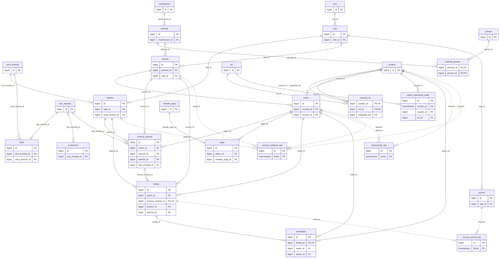
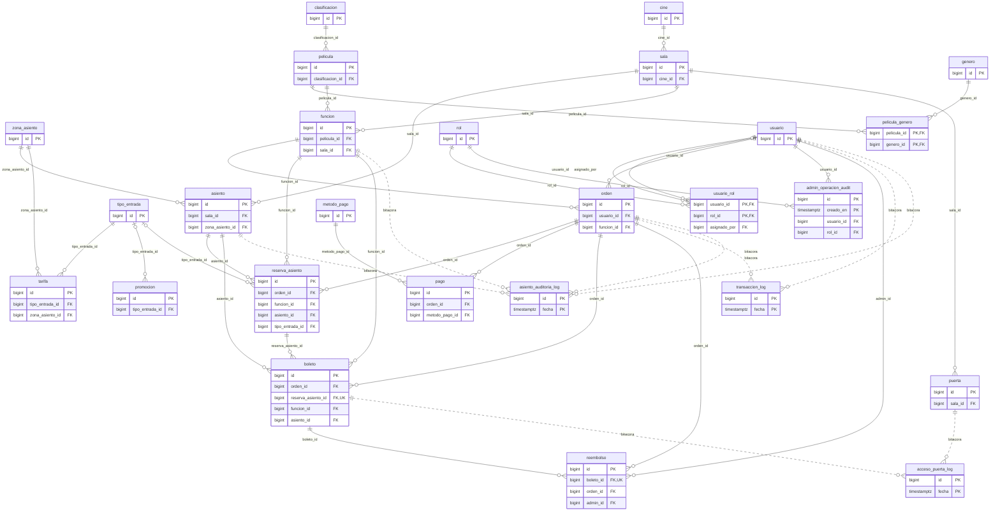

# Diseño integrado de la base de datos

Este documento junta los tres módulos del proyecto en un solo modelo: el catálogo y la programación (módulo A, Matías), la venta de entradas (módulo B, Juan José) y la seguridad y el acceso en sala (módulo C, Brandon). El detalle de cada módulo está en su propio documento; aquí se ve cómo encajan.

## 1. Cómo está organizado

La base tiene **26 tablas** en PostgreSQL 16. Los módulos se cargan en este orden porque cada uno depende del anterior:

| Orden | Script | Qué crea |
|---|---|---|
| 1 | `01_catalogo.sql` | Cines, salas, asientos, películas, funciones, tarifas, promociones, y las tablas base `usuario`, `rol` y `usuario_rol` |
| 2 | `02_seguridad_usuarios.sql` | Intentos fallidos, bloqueo de cuenta y hash de contraseña (bcrypt con pgcrypto) |
| 3 | `03_venta.sql` | Órdenes, reservas de asiento, pagos, métodos de pago y boletos |
| 4 | `03_venta_logs.sql` | Bitácoras de venta, particionadas por mes |
| 5 | `04_seguridad_acceso.sql` | Puertas, bitácora de accesos, auditoría administrativa y reembolsos |
| 6 | `05_catalogo_logica.sql` | Total de la compra, cartelera y restricción de salas con ventas (RN-18) |
| 7 | `06_venta_logica.sql` | Mapa de asientos, bloqueo, tipos de entrada, pago, mis boletos y expiración |
| 8 | `07_seguridad_logica.sql` | Autenticación, check-in por QR, reembolsos y auditoría |
| 9 | `08_roles_permisos.sql` | Roles de PostgreSQL y permisos por rol |
| 10 | `09_venta_indices.sql` y `10_catalogo_indices.sql` | Índices de reportes y cartelera |

`database/ddl/ddls.sql` es la unión de todos, en este orden.

## 2. Diagrama entidad-relación

El diagrama se generó leyendo la base ya creada (llaves primarias y foráneas reales), así que coincide con el DDL. Para que se pueda leer solo se muestran las llaves; las columnas completas de la venta están en [modulo-venta.md](modulo-venta.md) y las del catálogo en [modulo-catalogo.md](modulo-catalogo.md).

Las líneas punteadas son las bitácoras (`asiento_auditoria_log`, `transaccion_log` y `acceso_puerta_log`). Se relacionan con las demás tablas por el id guardado, pero **sin llave foránea**, a propósito: son tablas particionadas por mes, solo admiten INSERT, y una llave foránea hacia ellas encarecería cada escritura. Guardan el id tal como estaba cuando ocurrió el evento.

## 3. Modelo relacional

PK = llave primaria. Las llaves foráneas se escriben como `columna → tabla`. Módulo A = catálogo, B = venta, C = seguridad.

| Tabla | Módulo | Llave primaria | Llaves foráneas |
|---|---|---|---|
| `asiento` | A | `id` | `sala_id` → `sala` `zona_asiento_id` → `zona_asiento` |
| `cine` | A | `id` | — |
| `clasificacion` | A | `id` | — |
| `funcion` | A | `id` | `sala_id` → `sala` `pelicula_id` → `pelicula` |
| `genero` | A | `id` | — |
| `pelicula` | A | `id` | `clasificacion_id` → `clasificacion` |
| `pelicula_genero` | A | `pelicula_id`, `genero_id` | `genero_id` → `genero` `pelicula_id` → `pelicula` |
| `promocion` | A | `id` | `tipo_entrada_id` → `tipo_entrada` |
| `sala` | A | `id` | `cine_id` → `cine` |
| `tarifa` | A | `id` | `zona_asiento_id` → `zona_asiento` `tipo_entrada_id` → `tipo_entrada` |
| `tipo_entrada` | A | `id` | — |
| `zona_asiento` | A | `id` | — |
| `asiento_auditoria_log` | B | `id`, `fecha` | — |
| `boleto` | B | `id` | `asiento_id` → `asiento` `funcion_id` → `funcion` `orden_id` → `orden` `reserva_asiento_id` → `reserva_asiento` |
| `metodo_pago` | B | `id` | — |
| `orden` | B | `id` | `funcion_id` → `funcion` `usuario_id` → `usuario` |
| `pago` | B | `id` | `metodo_pago_id` → `metodo_pago` `orden_id` → `orden` |
| `reserva_asiento` | B | `id` | `asiento_id` → `asiento` `funcion_id` → `funcion` `tipo_entrada_id` → `tipo_entrada` `orden_id` → `orden` |
| `transaccion_log` | B | `id`, `fecha` | — |
| `acceso_puerta_log` | C | `id`, `fecha` | — |
| `admin_operacion_audit` | C | `id`, `creado_en` | `rol_id` → `rol` `usuario_id` → `usuario` |
| `puerta` | C | `id` | `sala_id` → `sala` |
| `reembolso` | C | `id` | `admin_id` → `usuario` `orden_id` → `orden` `boleto_id` → `boleto` |
| `rol` | C | `id` | — |
| `usuario` | C | `id` | — |
| `usuario_rol` | C | `usuario_id`, `rol_id` | `rol_id` → `rol` `usuario_id` → `usuario` `asignado_por` → `usuario` |

Las tablas de bitácora llevan la fecha dentro de la llave primaria (`id`, `fecha`), porque PostgreSQL exige que la columna de partición forme parte de ella.

## 4. Decisiones de diseño que cruzan módulos

- **Un asiento solo se vende una vez por función.** Lo garantiza el índice único parcial `uq_asiento_activo` sobre `reserva_asiento (funcion_id, asiento_id)` para los estados `BLOQUEADO` y `VENDIDO`. No depende de la aplicación: si dos transacciones intentan el mismo asiento, la segunda falla.
- **Salas con ventas no se tocan (RN-18).** Dos triggers del módulo A consultan las órdenes y reservas del módulo B antes de permitir cambios en una sala; por eso `03_venta.sql` se carga antes que `05_catalogo_logica.sql`.
- **Un boleto es un dato de venta, y el acceso en sala lo consume.** `fn_validar_entrada` (módulo C) lee `boleto.codigo_qr`, `boleto.estado` y `boleto.funcion_id`, y marca el boleto como `USADO`. `fn_reembolsar` lo anula y libera el asiento.
- **Las contraseñas se guardan con hash.** `usuario.password_hash` se calcula con `crypt()` y `gen_salt('bf')` de pgcrypto; la autenticación pasa por `fn_autenticar`.
- **Los permisos viven en la base.** `08_roles_permisos.sql` crea un rol de PostgreSQL por cada rol del negocio y le otorga solo lo que necesita (matriz en [rbac-matriz.md](../rbac-matriz.md)).
- **Bitácoras inalterables y con retención.** Las tres bitácoras y la auditoría administrativa se particionan por mes y un trigger rechaza `UPDATE` y `DELETE`. `fn_crear_particiones_mes(fecha)` crea las particiones del mes de esa fecha en las bitácoras de venta, y `fn_liberar_expirados` la llama cada vez que corre para que siempre exista la del mes actual.

## 5. Datos de demostración y datos masivos

| Script | Contenido |
|---|---|
| `01_catalogo_demo.sql` | 3 cines, 4 salas, 128 asientos, 8 funciones, tarifas, promociones y un usuario por rol |
| `10_metodos_pago.sql` | Los tres métodos de pago simulados |
| `10_seed_seguridad.sql` | Puertas y operaciones de auditoría de ejemplo |
| `11_seed_venta.sql` | 6 órdenes: 3 pagadas, 1 rechazada, 1 vencida y 1 con bloqueo vigente |
| `12_masivo_catalogo.sql` | Unas 900 000 funciones, 1 500 salas y 270 000 asientos para medir rendimiento |
| `14_masivo_venta.sql` | Unas 726 000 órdenes pagadas y más de 2 millones de boletos |