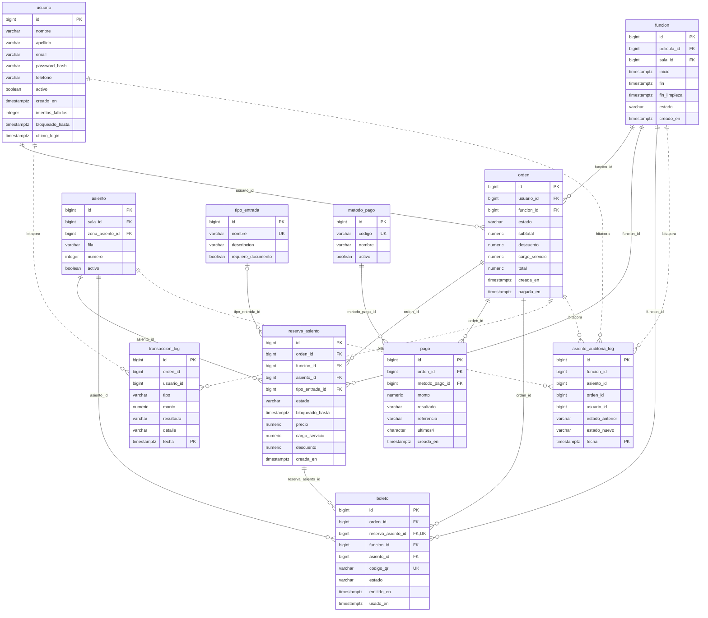
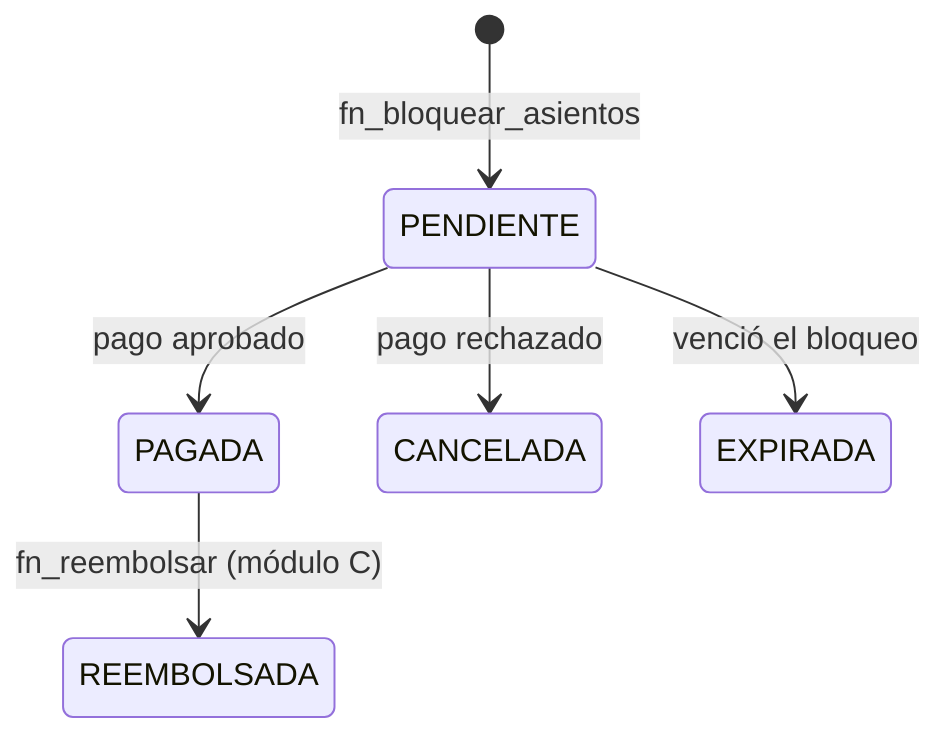
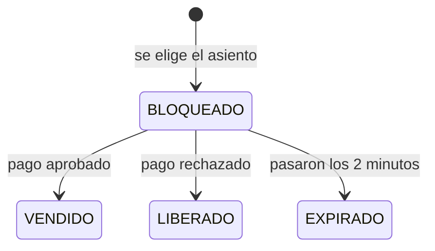
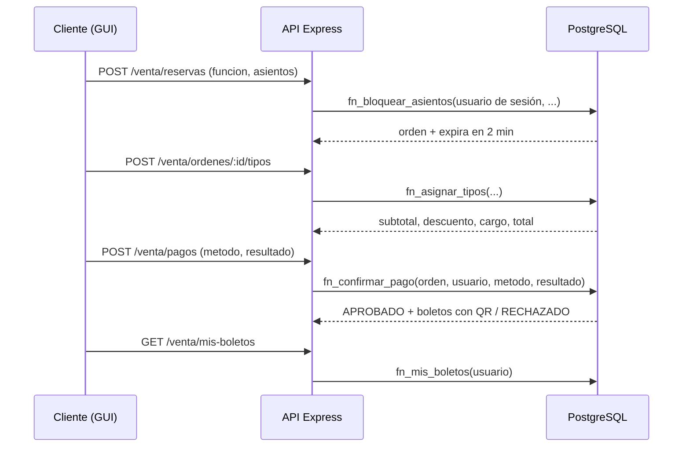

# Módulo B: venta de entradas, bloqueo de asientos y pago

**Responsable:** Juan José Morales Montero
**Scripts:** `database/ddl/03_venta.sql`, `03_venta_logs.sql`, `06_venta_logica.sql`, `09_venta_indices.sql`
**Datos y consultas:** `seeds/10_metodos_pago.sql`, `seeds/11_seed_venta.sql`, `seeds/14_masivo_venta.sql`, `queries/19_consulta_ocupacion.sql`, `queries/21_consulta_metodos_pago.sql`
**Interfaz:** `app/src/routes/venta.js`, `app/public/venta/` (mapa, pago, mis entradas y reportes)

## 1. Alcance

Este módulo cubre todo lo que pasa desde que el cliente elige asientos hasta que tiene su boleto con QR: ver el mapa de la sala, bloquear asientos por 2 minutos, elegir el tipo de entrada, pagar (simulado) y consultar sus boletos. También guarda las bitácoras de venta y calcula los reportes de ocupación, recaudación y métodos de pago.

Reglas de negocio que cubre: RN-03, RN-04, RN-05, RN-08 (con el cálculo del módulo A), RN-09, RN-10, RN-11, RN-12, RN-13 y la parte de RN-20 que corresponde a las bitácoras de venta.

## 2. Diagrama entidad-relación

Tablas del módulo con sus columnas, y las tablas de otros módulos con las que se relacionan (`usuario`, `funcion`, `asiento`, `tipo_entrada`). Las líneas punteadas son las bitácoras, que guardan los ids sin llave foránea.




## 3. Tablas

| Tabla | Para qué sirve |
|---|---|
| `metodo_pago` | Catálogo de métodos simulados: `TARJETA_SIMULADA`, `PAYPAL_SIMULADO`, `BILLETERA_SIMULADA`. |
| `orden` | Una compra. Guarda el usuario, la función, el estado y los totales (`subtotal`, `descuento`, `cargo_servicio`, `total`). |
| `reserva_asiento` | Un asiento dentro de una orden: su estado, el precio, el cargo y hasta cuándo está bloqueado. |
| `pago` | Cada intento de pago de una orden, aprobado o rechazado. Solo guarda una referencia simulada y, opcionalmente, los últimos 4 dígitos. |
| `boleto` | Un boleto por asiento vendido, con su código QR único. |
| `asiento_auditoria_log` | Cada cambio de estado de un asiento (bloqueado, vendido, liberado, expirado). |
| `transaccion_log` | Cada paso de la compra: bloqueo, pago, liberación, expiración y emisión de boleto. |

Las dos bitácoras están particionadas por mes (`PARTITION BY RANGE (fecha)`) y un trigger rechaza cualquier `UPDATE` o `DELETE`.

### Estados





El boleto nace `EMITIDO` y pasa a `USADO` (check-in en puerta) o `ANULADO` (reembolso).

## 4. Cómo se evita la doble venta

La garantía está en la base de datos, no en la aplicación. En `03_venta.sql`:

```sql
create unique index uq_asiento_activo
    on reserva_asiento (funcion_id, asiento_id)
    where estado in ('BLOQUEADO', 'VENDIDO');
```

Es un índice único **parcial**: solo cuenta las reservas activas. Un asiento liberado o expirado deja de estar en el índice y otro cliente puede tomarlo; uno bloqueado o vendido no. Si dos clientes intentan el mismo asiento a la vez, PostgreSQL deja pasar una inserción y a la otra le responde con `unique_violation`. `fn_bloquear_asientos` atrapa ese error y lo convierte en el mensaje "Asiento no disponible: otro usuario lo tiene bloqueado o comprado"; como todo corre en una sola transacción, la orden que se había empezado a crear se deshace.

Otras dos restricciones complementan esta:

- `uq_pago_aprobado`: una orden solo puede tener un pago aprobado. Evita cobrar dos veces si el cliente hace doble clic en "Pagar".
- `boleto.reserva_asiento_id` y `boleto.codigo_qr` son únicos: una reserva produce a lo sumo un boleto y no hay dos boletos con el mismo QR (RN-12).

`fn_asignar_tipos` y `fn_confirmar_pago` además bloquean la fila de la orden con `for update`, para que dos peticiones sobre la misma orden se ejecuten una después de la otra.

## 5. Funciones

Todas están en `06_venta_logica.sql`. La aplicación solo las llama; no hay lógica de negocio en el JavaScript.

| Función | Qué hace |
|---|---|
| `fn_mapa_asientos(funcion)` | Devuelve cada asiento de la sala con su estado: `VENDIDO`, `BLOQUEADO` (solo si el bloqueo sigue vigente) o `DISPONIBLE`. |
| `fn_bloquear_asientos(usuario, funcion, asientos[])` | Valida de 1 a 6 asientos sin repetir, que la función esté activa y sea futura y que los asientos sean de su sala. Crea la orden `PENDIENTE`, bloquea los asientos por 2 minutos y escribe las bitácoras. Devuelve el id de la orden (`reserva_id`) y cuándo expira. |
| `fn_asignar_tipos(orden, usuario, asientos[], tipos[])` | Guarda el tipo de entrada de cada asiento. Usa `fn_calcular_total` del módulo A para aplicar tarifa, 2x1 y cargo por servicio, y actualiza los totales de la orden. Devuelve el desglose. |
| `fn_confirmar_pago(orden, usuario, metodo, resultado)` | Pago simulado. Aprobado: asientos `VENDIDO`, orden `PAGADA` y un boleto con QR único por asiento. Rechazado: asientos `LIBERADO` al instante y orden `CANCELADA`. Todo en una transacción. |
| `fn_mis_boletos(usuario)` | Boletos de un usuario con película, sala, asiento, fecha y estado, los más próximos primero. |
| `fn_liberar_expirados()` | Marca como `EXPIRADO` los bloqueos vencidos y como `EXPIRADA` las órdenes sin asientos activos. Se llama al inicio de `fn_bloquear_asientos`. |

### Flujo de una compra



El usuario siempre sale de la sesión, nunca del cuerpo de la petición. El servidor rechaza con 400 cualquier petición de pago que traiga campos de tarjeta (`numero_tarjeta`, `cvv`, etc.), y la tabla `pago` no tiene columnas para guardarlos (RN-09).

## 6. Bloqueo de 2 minutos y liberación

El bloqueo es un dato (`reserva_asiento.bloqueado_hasta`), no un proceso en segundo plano. Un bloqueo vencido deja de contar en el mapa en el mismo momento (`fn_mapa_asientos` compara contra `now()`), y se limpia de verdad la próxima vez que alguien intenta bloquear (`fn_liberar_expirados`). Así no hace falta un temporizador ni un job externo, y el asiento se puede volver a tomar aunque nadie haya corrido la limpieza.

`fn_confirmar_pago` rechaza el pago si el bloqueo ya venció. El contador de la pantalla es solo informativo.

## 7. Índices

Además de los índices únicos de `03_venta.sql`, `09_venta_indices.sql` agrega:

| Índice | Para qué |
|---|---|
| `idx_boleto_funcion` (parcial, sin anulados) | Contar boletos de una función (consulta 1) |
| `idx_orden_funcion_estado` | Sumar lo recaudado por función (consulta 1) |
| `idx_orden_usuario` y `idx_boleto_orden` | Mis boletos |
| `idx_reserva_bloqueo` (parcial, solo `BLOQUEADO`) | Encontrar bloqueos vencidos |

La consulta 3 (métodos de pago) no lleva índice: lee más del 90 % de la tabla `pago`, y en ese caso el recorrido completo es lo correcto. Las mediciones están en [04-pruebas/venta.md](../04-pruebas/venta.md).

## 8. Consultas analíticas

- **Consulta 1, ocupación y recaudación de una función** (`19_consulta_ocupacion.sql`): porcentaje de asientos vendidos frente a la capacidad de la sala e ingresos de las órdenes pagadas. Los boletos anulados y las órdenes reembolsadas no cuentan.
- **Consulta 3, métodos de pago** (`21_consulta_metodos_pago.sql`): cantidad, porcentaje de uso y monto de los pagos aprobados por método. Los métodos sin uso salen con cero.

Las dos tienen su ruta en la API (`/api/venta/reportes/ocupacion?funcion_id=` y `/api/venta/reportes/metodos-pago`), solo para administrador y contador, y la pantalla `app/public/venta/reportes.html`.

## 9. Límites que conviene conocer

- El pago es simulado. No hay pasarela: el resultado `APROBADO` o `RECHAZADO` lo elige quien usa la pantalla.
- Las funciones de venta reciben el id del usuario como parámetro. La aplicación lo toma de la sesión, pero la base confía en lo que le llegan; no hay un rol de PostgreSQL por usuario final.
- Los reembolsos y el uso del boleto en puerta son del módulo C (`fn_reembolsar` y `fn_validar_entrada`).